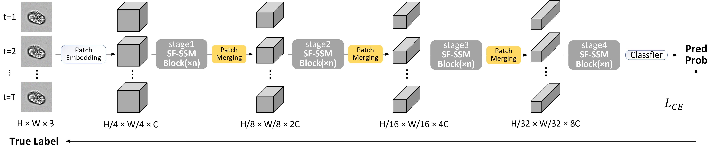
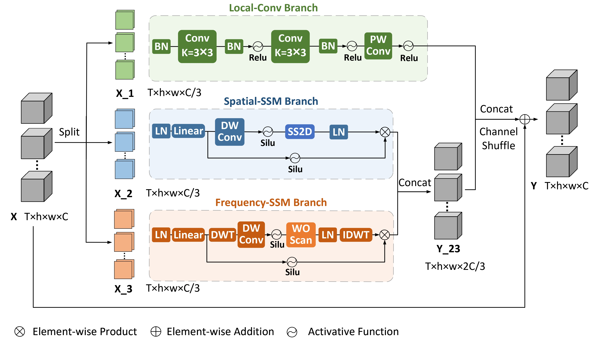

<div align="center">

<h1>SFCell</h1>

<h2>Spatial-Frequency Driven Mamba for High-performance Unstained Cell Classification</h2>

<p>

Xinyun Wang<sup>1,2,3,&#42;</sup>,
Boyao Wan<sup>2,&#42;</sup>,
Kewei Zong<sup>2</sup>,
Lei Kang<sup>4</sup>,
Xu Ding<sup>4</sup>,
Jing Yang<sup>4</sup>,
Yan Chen<sup>4,†</sup>,
Jiarui Han<sup>4</sup>,
Haofeng Li<sup>1,†</sup>,
and Lian Zhang<sup>2,†</sup>
</p>

<p>
<sup>1</sup> School of Systems Science and Engineering, Sun Yat-sen University, Guangzhou, China<br>
<sup>2</sup> Shenzhen Research Institute of Big Data, Shenzhen, China<br>
<sup>3</sup> Zhejiang Normal University, Jinhua, China<br>
<sup>4</sup> Shenzhen Raymind Biotechnology Co., Ltd., Shenzhen, China
</p>

<p>
<sup>&#42;</sup> Equal contributions.
&nbsp;&nbsp;
<sup>†</sup> Corresponding authors.
</p>

<p>
<strong>ACCV 2026</strong>

</div> 


## Abstract

Automated classification of unstained blood cells in bright-field microscopy is a non-invasive and cost-effective paradigm for rapid disease screening. However, the task is inherently difficult due to the extremely low contrast and subtle morphological differences between cell types in image sequences, which often challenge conventional deep learning models. In this paper, we propose SFCell, a Spatial-Frequency Driven Mamba network designed to enhance discriminative feature extraction from tracked cell sequences. In the SFCell architecture, we introduce a new Spatial-Frequency SSM block, which contains a convolution branch for modeling local structures, a Spatial-SSM branch for harvesting global dependencies, and a Frequency-SSM branch for mining frequency-relevant patterns. The Frequency-SSM branch leverages the Discrete Wavelet Transform (DWT) to decompose latent features into the frequency domain, utilizing a Wavelet-Ordered Scan Mamba to capture multi-scale spectral patterns and temporal dynamics that are difficult to distinguish in the spatial domain. The features from all three branches are then fused to strengthen the interaction and robustness of deep features. %Experimental results on large-scale clinical datasets demonstrate that SFCell consistently outperforms the state-of-the-art methods in classification accuracy and F1-score.
Results on large-scale clinical datasets show that SFCell surpasses the state-of-the-art methods in classification accuracy and F1-score.


## Overview
SFCell is designed for unstained blood-cell classification from tracked bright-field microscopy sequences. Its Spatial-Frequency SSM block combines local convolution, spatial state-space modeling, and a DWT-based frequency branch with Wavelet-Ordered Scan to learn complementary spatial, frequency, and temporal representations.
<p align="center">
  
</p>
<p align="center">
  <em>Architecture of SFCell framework</em>
</p>
<p align="center">
  
</p>
<p align="center">
  <em>Architecture of Spatial-Frequency SSM Block</em>
</p>

## Main Files

The main files are:

| Path | Description |
| --- | --- |
| `SFCell_network.py` | SFCell and Spatial-Frequency SSM model definitions |
| `train_SFCell.py` | Unified training entry point for the 2-class and 3-class tasks |
| `test_SFCell.py` | Frame-level evaluation with released or custom weights |
| `postprocess_SFCell.py` | Aggregation of frame-level predictions into track-level results |
| `data/splits/` | Task-ready train, validation, test, and external-test CSV indexes; download them from the link below |
| `weights/` | Pretrained checkpoints; download them from the link below |
| `data/README.md` | Split statistics, CSV schema, and data-availability details |

## Environment

The repository currently targets Linux with an NVIDIA GPU and declares the following base environment:

- Python 3.8
- PyTorch 1.13.0
- torchvision 0.14.0
- CUDA-compatible `causal-conv1d` 1.0.0 and `mamba-ssm` 1.0.1

Create an environment and install the declared dependencies:

```bash
conda create -n sfcell python=3.8 -y
conda activate sfcell
pip install -r requirements.txt
```

## Data Preparation

[Download pretrained SFCell data from Google Drive](https://drive.google.com/drive/folders/1t5iRjxyr2--oDqVbcto7pRK7ZeP7UkE7?usp=drive_link)
The task-ready indexes are under `data/splits/`:

```text
data/splits/
|-- chc_wbc/
|   |-- train.csv
|   |-- val.csv
|   |-- test.csv
|   `-- external_test.csv
`-- wbc_3class/
    |-- train.csv
    |-- val.csv
    `-- external_test.csv
```

Each CSV contains four columns:

| Column | Description |
| --- | --- |
| `image_file_path` | Image path relative to the repository root, or an absolute path |
| `track_id` | Source-aware identifier for one tracked cell |
| `frame_idx` | Frame index used to restore temporal order |
| `cell_type` | Task label |

Example:

```csv
image_file_path,track_id,frame_idx,cell_type
data/example/cell_0001_001.png,video01_t0001,1,CHC
data/example/cell_0001_002.png,video01_t0001,2,CHC
```

The expected labels and their fixed index order are:

| Task | `--task` | Class order |
| --- | --- | --- |
| CHC-WBC | `2cls` | `CHC`, `WBC` |
| WBC subtypes | `3cls` | `CD14`, `CD3`, `CD66b` |

For the 3-class task, source rows labeled `CD16` are normalized to `CD66b`. Split data by `track_id` before sequence construction so that frames from the same tracked cell never cross training, validation, and test sets.

Raw clinical videos and cell images are not intended for public distribution because of privacy, contractual, and proprietary restrictions. When authorized images are available, preserve the directory layout referenced by `image_file_path`. See [data/README.md](data/README.md) for complete split statistics and construction details.

## Train SFCell

The training script supports both tasks through `--task`. By default, an interrupted run resumes from `training_checkpoint.pth` in the output directory; pass `--no_resume` to start over.

### CHC-WBC binary classification

```bash
python train_SFCell.py \
  --task 2cls \
  --train_csv data/splits/chc_wbc/train.csv \
  --val_csv data/splits/chc_wbc/val.csv \
  --test_csv data/splits/chc_wbc/test.csv \
  --output_dir training_results/sfcell_2cls \
  --wave haar \
  --J 2 \
  --target_size 128 \
  --num_epochs 300 \
  --patience 30 \
  --lr 1e-3 \
  --weight_decay 0.01 \
  --batch_size 32 \
  --max_seq_length 10 \
  --seed 0 \
  --gpu_id 0
```

### WBC three-class classification

```bash
python train_SFCell.py \
  --task 3cls \
  --train_csv data/splits/wbc_3class/train.csv \
  --val_csv data/splits/wbc_3class/val.csv \
  --output_dir training_results/sfcell_3cls \
  --wave haar \
  --J 2 \
  --target_size 128 \
  --num_epochs 300 \
  --patience 30 \
  --lr 1e-3 \
  --weight_decay 0.01 \
  --batch_size 32 \
  --max_seq_length 10 \
  --seed 0 \
  --gpu_id 0
```

The 2-class model is selected by validation macro-F1, while the 3-class model is selected by validation accuracy. A training directory contains:

- `class_indices.json`
- `log/training.log`
- `training_history.csv`
- `training_curves.png`
- `SFCell_<task>_best_val.pth`
- `SFCell_<task>_best_test.pth` when `--test_csv` is supplied

## Model Weights

Pretrained checkpoints are hosted on Google Drive and are not included in this repository:

[Download pretrained SFCell weights from Google Drive](https://drive.google.com/drive/folders/1pRDB6Z0Ddo36HvyXCRpdGZiiED-yv9uF?usp=drive_link)

After downloading, place the checkpoints as follows:

```text
weights/
|-- SFCell_2cls_best_test.pth
`-- SFCell_3cls_best_test.pth


## Evaluation on Released Weights

### CHC-WBC internal test set

```bash
python test_SFCell.py \
  --task 2cls \
  --csv_dir data/splits/chc_wbc/test.csv \
  --weight_path weights/SFCell_2cls_best_test.pth \
  --output_dir outputs/chc_wbc_test \
  --wave haar \
  --J 2 \
  --target_size 128 \
  --batch_size 32 \
  --max_seq_length 10 \
  --gpu_id 0
```

To evaluate the same checkpoint on the external set, replace the CSV with `data/splits/chc_wbc/external_test.csv` and choose a different output directory.

### WBC three-class external test set

```bash
python test_SFCell.py \
  --task 3cls \
  --csv_dir data/splits/wbc_3class/external_test.csv \
  --weight_path weights/SFCell_3cls_best_test.pth \
  --output_dir outputs/wbc_3class_external \
  --wave haar \
  --J 2 \
  --target_size 128 \
  --batch_size 32 \
  --max_seq_length 10 \
  --gpu_id 0
```

Evaluation writes `test.log`, `preds_test.csv`, `confusion_matrix.png`, and `class_indices.json` to the selected output directory. `preds_test.csv` stores the ground-truth class index and per-class probabilities for each valid frame.


## Track-level Post-processing

Aggregate frame-level predictions into tracked-cell predictions after evaluation:

```bash
python postprocess_SFCell.py \
  --task 2cls \
  --preds_test_csv outputs/chc_wbc_test/preds_test.csv \
  --test_csv data/splits/chc_wbc/test.csv \
  --output_dir outputs/chc_wbc_test \
  --max_seq_length 10
```

For the 3-class external set, change `--task`, the prediction CSV, test CSV, class-index file, and output directory accordingly. The post-processing script writes track predictions, aggregate metrics, per-class metrics, a confusion-matrix CSV, and a log file.

## Model Variants and Main Options

SFCell uses the configuration in all released training and evaluation scripts:

| Stage depths | Stage dimensions |
| --- | --- |
| `[2, 2, 4, 2]` | `[96, 192, 384, 768]` |

Other important options:

- `--wave`: wavelet basis; released weights use `haar`.
- `--J`: DWT decomposition level; released weights use `2`.
- `--max_seq_length`: maximum frames per temporal subsequence; released weights use `10`.
- `--disable_branch`: disable `spatial`, `frequency`, or `local` for an ablation; `none` uses all branches.
- `--num_workers`: data-loader workers. Training uses `-1` for automatic selection; evaluation uses automatic selection when omitted.
- `--seed`: random seed.
- `--gpu_id`: CUDA device index; scripts fall back to CPU when CUDA is unavailable.

Run a script with `--help` to see its full argument list.


## Citation

Citation information will be updated when the official publication metadata becomes available.
